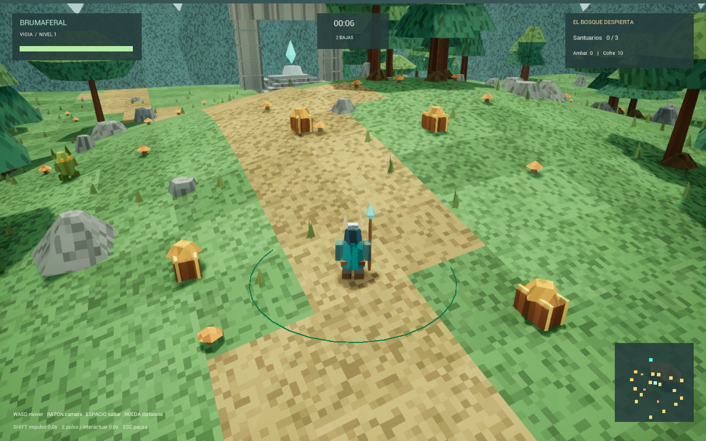

# MEGABONK2 — Brumaferal

Roguelite de supervivencia en tercera persona, original, inspirado en las *sensaciones* de MEGABONK (cámara amplia, movimiento fluido, saltos, hordas, ataque automático y elección de mejoras). Meta: **1 jugador o cooperativo de hasta 6**, con clases diferentes y estética retro 3D propia.

> No se usa código, modelos, texturas, sonidos ni interfaz de MEGABONK. Todo el arte actual se genera por código.

**Estado actual:** Entrega 1, jugable **en solitario**. Es una base que funciona, no un producto terminado. El análisis técnico completo, los fallos conocidos y la hoja de ruta están en **[docs/ANALISIS.md](docs/ANALISIS.md)**.



---

## 1. Contenido del repositorio

| Ruta | Qué es |
|---|---|
| `Brumaferal/` | **Proyecto vigente** (Unreal Engine 5.8, C++). Aquí se trabaja. |
| `Riftbound/` | Primer intento, **rechazado** por verse demasiado básico. Se conserva solo como referencia técnica (clases, reanimación, guardado, prueba de red con 6 conexiones). No continuar su diseño. |
| `Documentacion/` | Material de traspaso desde ChatGPT/Codex: estado detallado, documentos originales, conversaciones de diseño y el **prompt maestro** con los criterios de aceptación. |
| `docs/` | Documentación del equipo: análisis técnico e imágenes. |
| `sources/` | Referencias de solo lectura (vacía por ahora). No editar. |
| `MANIFIESTO.json` | Inventario con SHA-256 de la exportación original (incluye archivos que no se suben a git). |
| `AGENTS.md` | Reglas para asistentes de IA que trabajen en el repo. |

Lectura recomendada para entrar al proyecto, en este orden:
1. Este README.
2. [docs/ANALISIS.md](docs/ANALISIS.md): arquitectura, parámetros, fallos y prioridades.
3. [Documentacion/contexto/adjuntos/Prompt_original_Brumaferal.txt](Documentacion/contexto/adjuntos/Prompt_original_Brumaferal.txt): la visión y los criterios de cada entrega.
4. [Documentacion/ESTADO_COMPLETO.md](Documentacion/ESTADO_COMPLETO.md): historia y estado con todo detalle.

---

## 2. Dependencias

Solo **Windows 10/11 x64**. No hay build para otras plataformas.

| Dependencia | Versión | Notas |
|---|---|---|
| **Unreal Engine** | **5.8** (validado con **5.8.2**) | Instalar desde Epic Games Launcher. Ruta esperada por los lanzadores: `C:\Program Files\Epic Games\UE_5.8`. |
| **Visual Studio** | 2022 (17.x) o 2026 | Cargas de trabajo **"Desarrollo de juegos con C++"** y **"Desarrollo para el escritorio con C++"**. El build original usó VS 2026 Community con MSVC **14.51**. Unreal avisa que es más nuevo que su preferido (14.50); compila igualmente. |
| **Windows SDK** | 10.0.26100.0 (o compatible) | Se instala con Visual Studio. |
| **.NET** | Incluido con Unreal | No hay que instalar nada aparte. |
| **Git** | 2.40+ | Para colaborar. |

Plugins de Unreal que usa el proyecto. **Vienen con el motor**, no hay que descargarlos:
- `ProceduralMeshComponent`: toda la geometría (terreno, árboles, personaje, enemigos).
- `PythonScriptPlugin`: solo para regenerar materiales con `Tools/materials.py`.

Módulos C++: `Core`, `CoreUObject`, `Engine`, `InputCore`, `ProceduralMeshComponent`.

No hay dependencias de terceros, ni Steam SDK, ni paquetes externos.

Hardware de referencia: Ryzen 7 7700X y RTX 4070 Ti SUPER, a 1440×900. Ahí la escena de prueba con unos 55 enemigos dio 3,17 ms por fotograma de media y 4,12 ms en el percentil 95.

---

## 3. Primeros pasos

### 3.1 Clonar

```powershell
git clone https://github.com/ricchdavidd/MEGABONK2.git C:\Dev\MEGABONK2
```

> **Recomendado:** clonar en una ruta corta y **fuera de OneDrive/Dropbox**. Unreal genera miles de archivos temporales; la sincronización en la nube bloquea archivos y rompe compilaciones. Las rutas largas también dan problemas en Windows.

### 3.2 Compilar (obligatorio la primera vez)

Los binarios **no** se suben al repo, así que hay que compilar después de clonar.

**Opción A, interfaz:** doble clic en `Brumaferal/Brumaferal.uproject`. Cuando pregunte si quieres recompilar los módulos, responde **Sí**.

**Opción B, terminal (PowerShell):**

```powershell
cd C:\Dev\MEGABONK2\Brumaferal
& "C:\Program Files\Epic Games\UE_5.8\Engine\Build\BatchFiles\Build.bat" BrumaferalEditor Win64 Development -Project="$PWD\Brumaferal.uproject" -WaitMutex
```

El resultado debe terminar en `Result: Succeeded`.

Para editar en Visual Studio: clic derecho en `Brumaferal.uproject` → **Generate Visual Studio project files** → abrir `Brumaferal.sln`. El `.sln` no se versiona. La configuración es **Development Editor / Win64**.

### 3.3 Jugar

```powershell
cd C:\Dev\MEGABONK2\Brumaferal
.\Jugar.cmd
```

O directamente:

```powershell
& "C:\Program Files\Epic Games\UE_5.8\Engine\Binaries\Win64\UnrealEditor.exe" "$PWD\Brumaferal.uproject" /Engine/Maps/Entry -game -windowed -ResX=1440 -ResY=900
```

Si Unreal está instalado en otra ruta, cambia la ruta del ejecutable o abre el `.uproject` con tu motor.

Espera a que aparezca el bosque, haz clic en la ventana y pulsa **Enter**.

| Tecla | Acción |
|---|---|
| Enter | Empezar / reiniciar |
| WASD | Moverse (relativo a la cámara) |
| Ratón / Rueda | Girar la cámara / distancia de cámara |
| Espacio | Saltar |
| Shift izq. | Impulso evasivo |
| E | Pulso de área; cerca de un cofre o santuario: interactuar |
| 1 / 2 / 3 | Elegir mejora: brote múltiple / aura / fuerza y curación |
| Esc | Pausa (solo un jugador) |

Objetivo: recoge cristales, abre cofres (10 de ámbar) y activa 3 santuarios para invocar al guardián, que también aparece a los 4 minutos. Derrótalo para ganar.

---

## 4. Pruebas automáticas

Ejecutar desde `Brumaferal/` **antes de abrir un PR**.

**Prueba funcional sin gráficos (`BrumaAudit`):** comprueba suelo, desplazamiento, cámara, salto, XP, mejoras, cristal, cofre, santuario, victoria y reinicio. El proceso termina con código 0 si pasa y 1 si falla.

```powershell
& "C:\Program Files\Epic Games\UE_5.8\Engine\Binaries\Win64\UnrealEditor-Cmd.exe" "$PWD\Brumaferal.uproject" /Engine/Maps/Entry -game -nullrhi -nosound -unattended -BrumaAudit -abslog="$PWD\Tools\audit.log"
Select-String "BRUMA_AUDIT" Tools\audit.log
```

Resultado esperado: `BRUMA_AUDIT PASS pickup=1 chest=1 shrine=1 victory=1 restart=1`.

**Prueba visual con gráficos (`BrumaVisualAudit`):** hace un recorrido automático, genera 55 enemigos, toma capturas en `Saved/Screenshots/Forest.png` y `Combat.png` y mide los tiempos de fotograma.

```powershell
& "C:\Program Files\Epic Games\UE_5.8\Engine\Binaries\Win64\UnrealEditor.exe" "$PWD\Brumaferal.uproject" /Engine/Maps/Entry -game -windowed -ResX=1440 -ResY=900 -nosound -unattended -BrumaVisualAudit -abslog="$PWD\Tools\visual-audit.log"
Select-String "BRUMA_RENDER" Tools\visual-audit.log
```

> Ambas pruebas usan ayudas (vida fija, acciones forzadas). **No sustituyen** jugar a mano: compilar y pasar las pruebas no demuestra que el juego se sienta bien.

**Regenerar materiales** (`M_Facet`, `M_Glow` y la textura de ruido 32×32). Solo hace falta si se cambia `Tools/materials.py`:

```powershell
& "C:\Program Files\Epic Games\UE_5.8\Engine\Binaries\Win64\UnrealEditor-Cmd.exe" "$PWD\Brumaferal.uproject" -run=pythonscript -script="$PWD\Tools\materials.py" -nullrhi -unattended -nosplash
```

---

## 5. Cómo colaborar

**Flujo de trabajo**
1. Crea una rama desde `main`: `feature/<tema>`, `fix/<tema>` o `docs/<tema>`.
2. Haz commits pequeños con mensajes claros (en español o inglés, pero coherentes).
3. Antes del PR: compila, pasa `BrumaAudit` y **juega con gráficos** la parte que cambiaste.
4. En la descripción del PR indica **qué cambiaste, cómo lo comprobaste y qué falta**. Adjunta una captura si el cambio es visual.
5. Al menos una persona revisa antes de fusionar a `main`.

**Reglas del proyecto**
- **Prioridad de trabajo:** movimiento y cámara → presentación visual → combate → progresión → cooperativo → contenido. No añadir contenido para tapar problemas de movimiento, cámara o aspecto.
- **Recursos originales:** nada extraído de MEGABONK.
- **No versionar** `Binaries/`, `Intermediate/`, `Saved/`, `DerivedDataCache/` ni `.sln`. El `.gitignore` ya los excluye.
- Los `.uasset` son binarios y **no se pueden fusionar**. Avisa al equipo antes de modificar uno; hoy solo hay 3, en `Content/Art`. Si el arte crece, habrá que activar **Git LFS**.
- **No modificar** `sources/` ni `Riftbound/`, salvo acuerdo explícito.
- **Parámetros de juego:** hoy están escritos directamente en el código (ver [docs/ANALISIS.md §3](docs/ANALISIS.md#3-parámetros-actuales)). Cuando los cambies, actualiza esa tabla.
- **No anunciar** soporte de red por Internet, Steam o cooperativo hasta que esté implementado **y probado**.

---

## 6. Problemas comunes

| Síntoma | Solución |
|---|---|
| "The following modules are missing or built with a different engine version" | Responder **Sí** para recompilar, o usar la Opción B de §3.2. Requiere Visual Studio con C++. |
| `Jugar.cmd` no abre nada | Revisar que Unreal esté en `C:\Program Files\Epic Games\UE_5.8`; si no, editar la ruta del `.cmd` en tu copia local. |
| En PowerShell, `Jugar.cmd` no se reconoce | Escribir `.\Jugar.cmd` (el `.\` es obligatorio). |
| Archivos bloqueados o compilación inestable | El proyecto está dentro de OneDrive: mover el clon fuera o pausar la sincronización. |
| Todo se ve gris o sin colores | No cargaron los materiales de `/Game/Art`. Regenerarlos con `materials.py` (§4). |
| La primera apertura tarda mucho | Normal: Unreal compila shaders la primera vez. |
