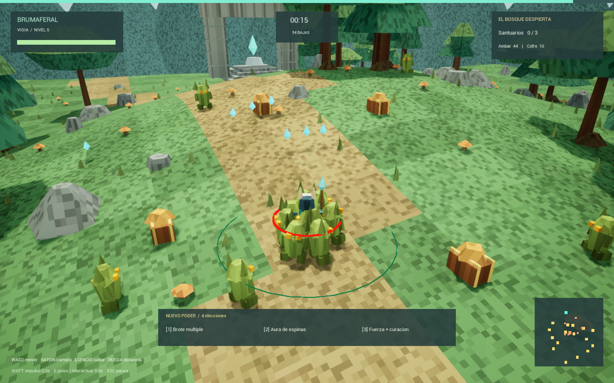

# Análisis técnico de Brumaferal

Revisión del código y de la documentación hecha el 8 de octubre de 2026 sobre el commit inicial (`Create first playable Brumaferal forest slice`). Distingue entre lo **implementado**, lo **verificado** y lo **pendiente**.

---

## 1. Resumen

- **El código es muy pequeño**: unas 550 líneas de C++ en 4 archivos, escritas de forma muy compacta, con varias sentencias por línea.
- **No hay mapa (`.umap`)**. Se arranca en `/Engine/Maps/Entry` y el `GroveMode` construye todo el mundo por código al iniciar.
- **Todo el arte es procedural**: triángulos con caras planas y color por vértice ([Facet.h](../Brumaferal/Source/Brumaferal/Facet.h)), más un material con una textura de ruido de 32×32 proyectada en el espacio del mundo, lo que da el aspecto pixelado.
- **La red está diseñada, pero no validada**: el estado se replica y el servidor tiene la autoridad. Nunca se ha probado Brumaferal con más de un jugador.

---

## 2. Arquitectura

| Clase | Archivo | Responsabilidad |
|---|---|---|
| `AGroveMode` (GameMode) | [Grove.cpp](../Brumaferal/Source/Brumaferal/Grove.cpp) | Crea el mundo, inicia y reinicia la partida, genera oleadas y al guardián, coloca recompensas, limita a 6 jugadores (`PreLogin`) y contiene **las pruebas automáticas** (`BrumaAudit`, `BrumaVisualAudit`). |
| `AGroveState` (GameState) | Grove.h / Grove.cpp | Replica `Phase` (0 inicio, 1 partida, 2 victoria, 3 derrota), `Kills`, `Shrines` y `Elapsed`. |
| `AGroveHero` (Character) | [GroveHero.cpp](../Brumaferal/Source/Brumaferal/GroveHero.cpp) | Movimiento, cámara (SpringArm), entradas, ataque automático, aura, pulso, impulso, XP y niveles, selección de mejora, daño recibido y modelo procedural con piernas animadas. |
| `AGroveEnemy` (Character) | Grove.cpp | 4 tipos con `Kind` (0 básico, 1 carga, 2 resistente, 3 guardián). IA de persecución, desvío local ante obstáculos, separación entre enemigos y ataques con aviso previo. |
| `AGroveReward` (Actor) | [GroveWorld.cpp](../Brumaferal/Source/Brumaferal/GroveWorld.cpp) | `Kind` 0 cristal (atracción y recogida), 1 cofre, 2 santuario. |
| `AGroveWorld` (Actor) | GroveWorld.cpp | Terreno de 52×52 celdas de 250 u, generado con la función `Height(x,y)`: senos más una meseta gaussiana. Añade 190 árboles, 120 rocas, ruinas, 3 santuarios, montañas de fondo, cúpula de cielo, sol y niebla. Semilla fija `74612`. |
| `AGroveHUD` (HUD) | Grove.cpp | HUD dibujado con Canvas: barras, tiempo, bajas, santuarios, ámbar, radar, panel de mejoras y pantallas de inicio, pausa y resultado. |
| `FFacet` | Facet.h | Utilidad de geometría: `Tri`, `Quad`, `Box`, `Cone`, `Crystal` y `Apply`, que carga `M_Facet`/`M_Glow` o usa un material de respaldo. |

**Flujo de una partida:** `GroveMode::BeginPlay` crea `AGroveWorld`. El jugador pulsa Enter, lo que llama a `Hero::Start` en el servidor y este a `Mode::BeginRun`. `BeginRun` limpia enemigos y recompensas, reinicia a los héroes y coloca 3 santuarios y 20 cofres con la semilla `719`. A partir de ahí, `Mode::Tick` genera oleadas, el guardián aparece con 3 santuarios o a los 240 s, matarlo da la victoria (`Phase=2`) y la derrota llega cuando no queda ningún héroe vivo (`Phase=3`).

**Red:**
- Las acciones del jugador (`Ability`, `Dash`, `Select`, `Start`) son RPC `Server, Reliable`.
- Los efectos visuales usan `Effect`, un `NetMulticast, Unreliable`.
- El daño solo se aplica con `HasAuthority()`.
- El movimiento usa la predicción del `CharacterMovementComponent`.

---

## 3. Parámetros actuales

Todos están escritos directamente en el código. No hay DataAssets ni tablas.

| Sistema | Valor | Dónde |
|---|---|---|
| Velocidad / aceleración / frenado | 760 / 5400 / 4200 | GroveHero.cpp:17 |
| Salto / gravedad / control aéreo | 820 / 1.9 / 0.8 | GroveHero.cpp:17 |
| Paso máximo / pendiente caminable | 48 / 48° | GroveHero.cpp:17 |
| Margen de salto: memoria / borde | 0.13 s / 0.11 s | GroveHero.cpp:56, 84 |
| Cámara: distancia, zoom, FOV | 1050, 650–1350 (pasos de 90), 85 | GroveHero.cpp:21–22, 54 |
| Cámara: pitch/yaw inicial, límites de pitch | -29/18, -70..-8 | GroveHero.cpp:39 |
| Sensibilidad de giro / vertical | 0.65 / 0.6 | GroveHero.cpp:52–53 |
| Ataque automático | cada 0.55 s, alcance 1350, 19×Poder, `Bolts` objetivos (máx. 5) | GroveHero.cpp:90–93 |
| Aura | radio 220+35·nivel, (5+3·nivel)×Poder cada 0.8 s, máx. nivel 8 | GroveHero.cpp:95 |
| Pulso (E) | 8 s de enfriamiento, radio 650, 42×Poder, empuje 700/240 | GroveHero.cpp:67–69 |
| Impulso (Shift) | 2.3 s de enfriamiento, 1550 horizontal + 180 vertical, 0.42 s de invulnerabilidad | GroveHero.cpp:61 |
| XP por nivel | nivel × 9; cada nivel cura 12 | GroveHero.cpp:59 |
| Cristal | 3 XP + 1 ámbar; atracción a 360 u, velocidad 850, recogida a 90 u | GroveWorld.cpp:114 |
| Cofre / santuario | 10 ámbar → 1 elección + 15 de vida / 15 XP + 25 de vida | GroveHero.cpp:65 |
| Enemigos: velocidad | 290 / 340 / 210 / 260 (básico / carga / resistente / guardián) | Grove.cpp:35 |
| Enemigos: vida | 28 / 28 / 95 / 1600, × (1 + 0.35·(vivos−1)) | Grove.cpp:125 |
| Oleadas | intervalo max(0.28, 1−t·0.002)/√vivos; tope 80; variantes desde 40 s | Grove.cpp:123–125 |

---

## 4. Verificado vs. pendiente

**Verificado** (registros en `Brumaferal/Tools/*.log` y capturas en `docs/img/` y `Brumaferal/Saved/Screenshots/`, generados en el PC original; ver [RUTAS_Y_ENTORNO_ORIGINAL.md](RUTAS_Y_ENTORNO_ORIGINAL.md)):
- Compila en Development Editor con UE 5.8.2.
- `BrumaAudit` PASS: suelo, desplazamiento > 600 u, cámara a > 400 u, salto de 194.7 u, XP, mejora, rechazo de mejora sin puntos, cristal, cofre, santuario, victoria y reinicio.
- `BrumaVisualAudit`: 3155 muestras, media de 3.17 ms y percentil 95 de 4.12 ms, con 55 enemigos extra.

**No verificado:**
- Una partida larga jugada a mano.
- Derrota manual.
- Mando.
- Multijugador de cualquier tipo, y el rechazo de un 7.º jugador.
- Latencia.
- Build Shipping.
- Otra PC.

---

## 5. Fallos y riesgos encontrados en el código

Ordenados por gravedad. **Ninguno está corregido todavía.**

| # | Problema | Ubicación | Efecto |
|---|---|---|---|
| 1 | Si el guardián cae por debajo de Z=-500 se ejecuta `Destroy()` sin contar su muerte, y `BossSpawned` sigue en `true` | [Grove.cpp:58](../Brumaferal/Source/Brumaferal/Grove.cpp#L58) | **La partida no se puede ganar**: el guardián no vuelve a aparecer. |
| 2 | Con `Gold<10` cerca de un cofre, `Ability` hace `return` sin lanzar el pulso | [GroveHero.cpp:65](../Brumaferal/Source/Brumaferal/GroveHero.cpp#L65) | La tecla E no hace nada cerca de cofres. |
| 3 | Elegir el aura en su nivel máximo (8) gasta la elección sin efecto | [GroveHero.cpp:60](../Brumaferal/Source/Brumaferal/GroveHero.cpp#L60) | Se pierde la mejora. |
| 4 | `SpawnActorDeferred` se usa sin comprobar si devuelve nulo | Grove.cpp:69, 114, 125 | Puede cerrar el juego si falla una aparición (los registros antiguos tienen avisos de colisión en `SpawnActor`). |
| 5 | Separación de enemigos O(n²): cada enemigo recorre a todos los demás en cada tick, y cada héroe hace varias búsquedas con `TActorIterator` | [Grove.cpp:52](../Brumaferal/Source/Brumaferal/Grove.cpp#L52), GroveHero.cpp:91, 95 | El coste crece mucho con 80 enemigos y 6 héroes. |
| 6 | `Start` solo funciona si el controlador es local en el servidor | [GroveHero.cpp:57](../Brumaferal/Source/Brumaferal/GroveHero.cpp#L57) | En cooperativo solo el anfitrión puede iniciar. Es posible que sea intencional, pero no está documentado. |
| 7 | El salto con margen de borde usa `LaunchCharacter` desde el cliente, sin pasar por el movimiento predicho | [GroveHero.cpp:56](../Brumaferal/Source/Brumaferal/GroveHero.cpp#L56) | En red puede producir correcciones y tirones. |
| 8 | La carga (`Kind==1`) aplica daño cada tick mientras su velocidad supera 800 | [Grove.cpp:54](../Brumaferal/Source/Brumaferal/Grove.cpp#L54) | Solo lo limita la invulnerabilidad de 0.65 s; es frágil si esa regla cambia. |
| 9 | Los enemigos ignoran el canal `Pawn` | [Grove.cpp:23](../Brumaferal/Source/Brumaferal/Grove.cpp#L23) | Atraviesan al héroe y se solapan; solo la separación los mantiene apartados. |
| 10 | Elegir mejora no pausa ni protege al jugador | — | Pendiente de diseño, sobre todo para cooperativo. |

---

## 6. Deuda técnica

- **Responsabilidades mezcladas:** `Grove.cpp` junta IA, reglas, oleadas, HUD y pruebas. Conviene separar `EnemyAI`, `EncounterDirector`, `Progression`, `HUD` y `Tests`, como pide el prompt maestro.
- **Estilo:** varias sentencias por línea dificultan revisar y depurar. Conviene reformatear cuando se toque cada archivo.
- **Datos:** pasar los parámetros a `UDataAsset` o `DataTable` para ajustarlos sin recompilar.
- **Efectos:** el combate usa `DrawDebugLine/Sphere/Circle`. Esos efectos no aparecen en builds Shipping, así que hay que cambiarlos por Niagara o mallas antes de distribuir.
- **Entrada:** se usa el sistema de entrada antiguo (Axis/Action mappings). Unreal ya escribió las clases de Enhanced Input en `DefaultInput.ini`; conviene migrar para tener reasignación de teclas y soporte de mando.
- **Pruebas:** viven dentro de `GroveMode::Tick` y se activan por línea de comandos. Habría que moverlas al framework de Automation o a Functional Tests.
- **Arte:** si se añade arte importado, activar Git LFS para `.uasset` y `.umap`.

---

## 7. Hoja de ruta propuesta

Sigue las prioridades del prompt maestro.

1. **Estabilizar la base:** corregir los fallos 1 a 5 de §5 y separar `Grove.cpp`.
2. **Movimiento y cámara:** sesión de juego manual con el equipo (bordes, pendientes, paredes y aterrizajes), y ajustes de sensibilidad.
3. **Feedback de combate:** proyectiles reales, impactos, números de daño, efectos de muerte y audio.
4. **Entrega 2, partida completa:** atacante a distancia, élite, guardián con fases y mejoras que cambien el comportamiento (rebotes, trayectorias, movilidad), con su equilibrio.
5. **Entrega 3, cooperativo:** 6 clases (resistencia, movilidad, daño concentrado, control, apoyo y dispositivos), sinergias, caída y reanimación, mejoras sin pausa global, desconexiones y prueba con anfitrión + 5 clientes. Aquí se puede reutilizar lo comprobado en Riftbound.
6. **Después:** guardado persistente, menús y opciones, accesibilidad, rendimiento, build Shipping y Steam.

---

## 8. Referencia: Riftbound

Fue la primera implementación, rechazada por su aspecto. Tiene piezas técnicas ya probadas que pueden servir para la Entrega 3:
- `FRiftClass`: 6 clases con estadísticas propias.
- `URiftSave`: guardado local con `USaveGame`.
- Reanimación de aliados caídos.
- Sala previa con selección de clase.
- `Test-Network.ps1`: prueba en local con anfitrión + 5 clientes, **pasada**.

Detalles en [Riftbound/VALIDACION.md](../Riftbound/VALIDACION.md) y [Riftbound/REFERENCIAS-MEGABONK.md](../Riftbound/REFERENCIAS-MEGABONK.md).
